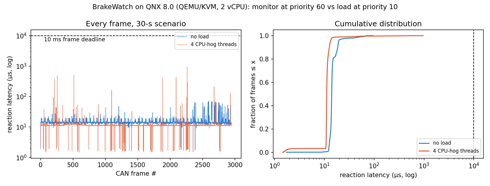

# BrakeWatch — a hard-deadline forward-collision watchdog on QNX 8.0

**QNX Global Hackathon 2026 · Category: Automotive & Mobility**

A car's collision warning is only useful if it arrives *on time, every time* — also when the infotainment system,
logging and over-the-air updates are hammering the same CPU. BrakeWatch is a small, complete forward-collision watchdog
that runs on QNX 8.0 and proves that property with measurements: it reads a CAN-like sensor stream at 100 Hz, computes
time-to-collision for every frame, raises **WARN / BRAKE** alerts and a **fail-safe SENSOR_STALE** alarm, and records the
reaction latency of every single decision — with and without heavy CPU load.



## Results (QNX 8.0 on QEMU/KVM, 2 vCPU, 2,951 frames per run)

| | No load | 4 CPU-hog threads (priority 10) |
|---|---|---|
| WARN raised at | 10.14 s | **10.14 s** |
| BRAKE raised at | 11.44 s | **11.44 s** |
| SENSOR_STALE (sensor cable dropout 18.0–18.5 s) | 18.03 s | **18.03 s** |
| Mean reaction latency | 15.5 µs | 12.7 µs |
| p99 | 53.3 µs | 30.5 µs |
| p99.9 | 69.4 µs | 485.6 µs |
| Worst frame | 94.3 µs | 960.3 µs |
| Frames over the 10 ms frame deadline | **0** | **0** |

Every safety decision, under load or not, happened at the same scenario moment and well inside the 10 ms deadline.
Raw data: [`results/latency_no_load.csv`](results/latency_no_load.csv), [`results/latency_full_load.csv`](results/latency_full_load.csv),
full QNX console: [`results/qnx_console.log`](results/qnx_console.log).

## How it works

```
 sensor thread (prio 40) ──MsgSend──►  monitor thread (prio 60)  ◄── 10 ms timer pulse (watchdog)
   100 Hz CAN-like frames              MsgReceive → TTC → OK/WARN/BRAKE → MsgReply
   (speed, gap, closing speed,          stamps ClockCycles() per decision
    brake pedal)                        no frame for 30 ms → SENSOR_STALE (fail-safe)

 N load threads (prio 10, SCHED_FIFO, busy loops)  = "infotainment / logging" pressure
```

QNX-specific pieces used (see [`src/brakewatch.c`](src/brakewatch.c)):

- **Native message passing** — `ChannelCreate`, `ConnectAttach`, `MsgSend`, `MsgReceive`, `MsgReply`. The sensor blocks
  until the monitor has decided, so the measured latency covers the full send → schedule → decide → reply path.
- **Timer pulses** — `timer_create` with `SIGEV_PULSE_INIT` delivers a 10 ms pulse to the same channel; the monitor
  uses it as a watchdog that fires `SENSOR_STALE` if no frame arrives for 30 ms.
- **Priority scheduling** — `SCHED_FIFO` priorities: monitor 60 > main 50 > sensor 40 > load 10.
- **Cycle-accurate timing** — `ClockCycles()` and `SYSPAGE_ENTRY(qtime)->cycles_per_sec`.

The scenario ([`src/scenario.c`](src/scenario.c)) is deterministic so every run sees the same input: cruising at
50 km/h, the car ahead brakes hard at 8 s, BrakeWatch warns at 10.1 s and alarms BRAKE at 11.4 s, the driver brakes at
11.7 s and stops 2.7 m short; at 18 s the radar cable is "unplugged" for half a second.

## A real bug QNX's priorities caught

The first loaded run never started the sensor: `main` ran at the same priority (10) as the four `SCHED_FIFO` CPU hogs,
so it never got the CPU back to create the sensor thread. The watchdog did exactly its job and raised SENSOR_STALE.
Fix: `main` runs at priority 50, the sensor starts before the load, and the watchdog arms only after the first frame.
This is the kind of start-up ordering mistake a real-time design review must catch — and a nice demonstration that the
fail-safe path works.

## Build and run

Tested with **QNX SDP 8.0** (QNX Everywhere, non-commercial), target **x86_64 on QEMU/KVM** built with `mkqnximage`,
toolchain `qcc -Vgcc_ntox86_64` (GCC 12.2).

```bash
source ~/qnx800/qnxsdp-env.sh
make                                   # -> ./brakewatch (QNX x86_64 binary)

# build and boot a QNX QEMU image with BrakeWatch baked in and auto-run
mkdir -p ~/vm && cd ~/vm && mkqnximage --type=qemu --arch=x86_64 --build
cp <repo>/results/data_files.custom  local/snippets/   # adds /data/var/brakewatch
cp <repo>/results/post_start.custom  local/snippets/   # runs both tests at boot
mkqnximage --build --noprompt && mkqnximage --run=-h   # console -> output/qemu.out
```

On a running QNX target you can also copy the binary and run it by hand:

```
./brakewatch -l 0 -t no_load       # no load
./brakewatch -l 4 -t full_load     # 4 CPU-hog threads
```

Each run prints state changes with their reaction time and writes `latency_<tag>.csv`.
A step-by-step tutorial is in [`CODELAB.md`](CODELAB.md).

## Honest limits

- The target is QEMU/KVM in a cloud VM, not automotive hardware. The rare spikes under load (10 of 2,951 frames above
  100 µs, worst 0.96 ms) most likely include host/hypervisor jitter; on bare metal they should be smaller. They are still
  ten times below the deadline.
- The sensor stream is synthetic and deterministic; there is no real CAN bus or radar.
- Time-to-collision logic is deliberately simple (gap / closing speed). The point of the project is the real-time
  architecture and its evidence, not a production ADAS algorithm.
- Mean latency is slightly lower under load, plausibly because busy vCPUs do not drop into idle states; we report it
  as measured.

## AI use (disclosure)

Code, scenario, analysis and documentation were written with the help of Claude (Anthropic) as a coding assistant;
every result in this README comes from the logged QNX runs in `results/`.

## Licence

MIT — see [`LICENSE`](LICENSE).
